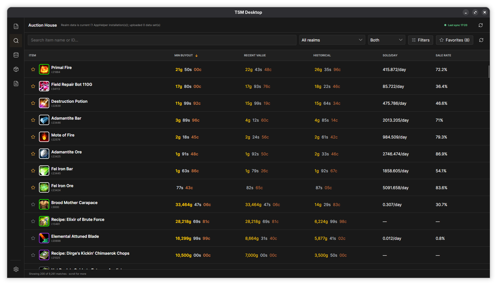
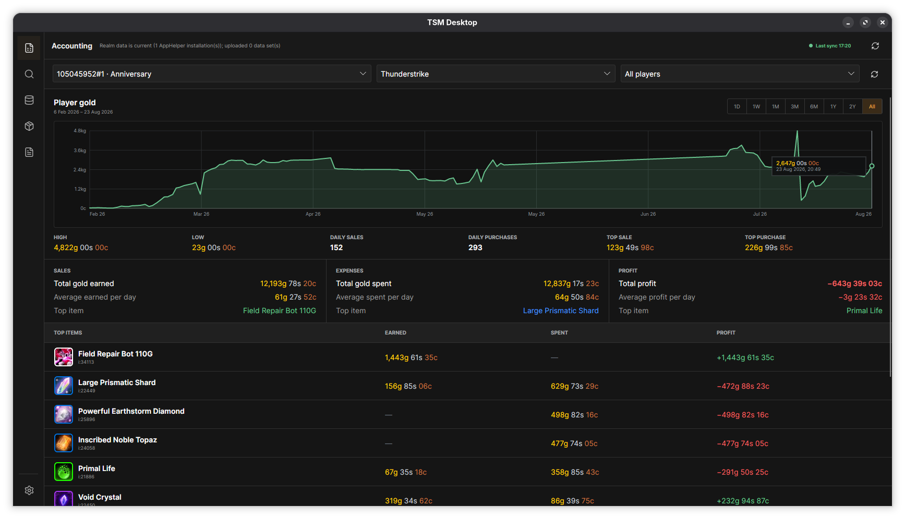
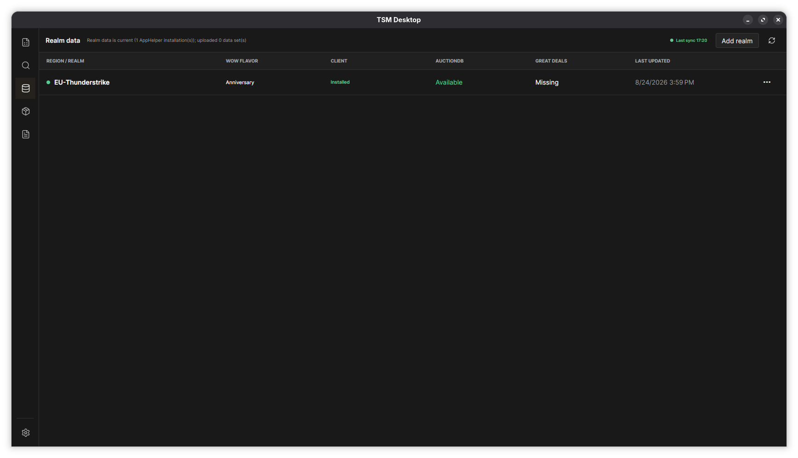
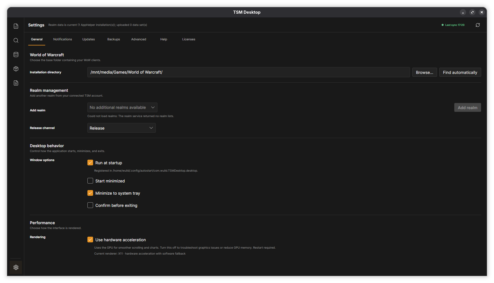

# TSM Desktop

[](LICENSE)
[](https://github.com/Wuild/TSM-App/releases/latest)

An unofficial TradeSkillMaster companion for Linux, Windows, and macOS.

TSM Desktop keeps your TradeSkillMaster data and addons up to date, lets you browse local Auction House data, and turns your Accounting history into useful charts and summaries. It is built especially for players who want a native TSM desktop experience on Linux, while also providing packages for Windows and Apple Silicon Macs.

[Download the latest release](https://github.com/Wuild/TSM-App/releases/latest) · [Report a problem](https://github.com/Wuild/TSM-App/issues) · [Build from source](#build-from-source)

> [!IMPORTANT]
> TSM Desktop is an independent, unofficial project. It is not affiliated with, authorized by, sponsored by, endorsed by, or supported by TradeSkillMaster LLC, Blizzard Entertainment, Wowhead, ZAM Network, or their affiliates. See the full [project notice](NOTICE.md).

## What you can do

- Keep AppHelper realm data synchronized in the background.
- Install AppHelper and update, reinstall, or remove TSM addons for each detected WoW client.
- Search and filter local Auction House data across your realms.
- Favorite items and collect local price history over time.
- Explore gold, sales, purchases, profit, and top items from TSM Accounting.
- Back up your TSM SavedVariables and restore them safely.
- Receive app updates without installing the .NET runtime separately.

## A quick look

### Browse the Auction House

Search by item name or ID, compare market values, filter by realm and faction, and pin favorites for quick access.



### Understand your Accounting data

Choose an account, realm, player, and time range to see gold history, sales, purchases, profit, and top-performing items.



### Keep realm data current

See which realms and WoW clients were detected, whether AuctionDB data is available, and when each realm was last updated.



### Configure it your way

Choose your WoW directory, release channel, startup behavior, notifications, backups, update preferences, and privacy options.



## Supported systems

| System | Package | Supported hardware |
| --- | --- | --- |
| Windows | Setup executable | x86_64 |
| macOS | DMG | Apple Silicon (Arm64) |
| Linux | AppImage | x86_64 |

Windows ARM, Intel Macs, and Linux ARM are not currently supported.

## Install

Download the package for your system from [GitHub Releases](https://github.com/Wuild/TSM-App/releases/latest). Release installers are self-contained; you do not need to install .NET. ZIP attachments are portable update packages and are not recommended for a normal installation.

### Windows

1. Download `TSM-<version>-windows-x86_64-setup.exe`.
2. Run the installer.
3. Open **TSM Desktop** from the Start menu.

The app installs for your user under `%LOCALAPPDATA%\Programs\TSM Desktop`, does not require administrator access, and appears in Windows' normal list of installed apps.

### macOS

1. Download `TSM-<version>-macos-arm64.dmg`.
2. Open the DMG and drag `TradeSkillMaster.app` to **Applications**.
3. Eject the disk image and launch the app from Applications.

The package requires an Apple Silicon Mac. If Gatekeeper blocks the first launch, right-click the app and choose **Open**, or allow it under **System Settings → Privacy & Security** after confirming that it came from this repository.

### Linux

1. Download `TSM-<version>-x86_64.AppImage`.
2. Make it executable:

   ```bash
   chmod +x TSM-<version>-x86_64.AppImage
   ```

3. Move it to a permanent, writable location such as `~/Applications` and run it:

   ```bash
   ./TSM-<version>-x86_64.AppImage
   ```

The AppImage is designed for x86_64 desktop distributions such as Ubuntu, Debian, Linux Mint, Fedora, Arch Linux, Manjaro, and openSUSE. Keep it in a writable location so automatic updates can replace it. If your distribution does not provide FUSE support, install its AppImage-compatible FUSE package or launch with `--appimage-extract-and-run`.

## First-time setup

1. Open TSM Desktop.
2. Select your base **World of Warcraft** directory, which contains client folders such as `_retail_`, `_forever_`, `_classic_`, and `_anniversary_`.
3. Choose your notification, startup, and tray preferences.
4. Sign in with your TradeSkillMaster account.
5. Install TradeSkillMaster for the WoW clients you use, then use **Addons → Install** to add AppHelper to each client.

The app can find common WoW locations automatically. Saved credentials are stored in Windows Credential Manager, macOS Keychain, or Linux Secret Service; your password is never written to `settings.json`.

WoW: Forever uses `_forever_` and requires TradeSkillMaster 4.15 or later with AppHelper. Accounting uses rulesets, and the Market data and Auction House views distinguish Forever markets by region, ruleset, and faction when that information is available. Automatic price downloads depend on the legacy TSM service supplying Forever data.

> [!TIP]
> If the Auction House is empty, make sure AppHelper is installed, then synchronize the market again from the **Market data** page.

## How the main features work

### Realm synchronization

TSM Desktop watches your configured WoW directory for new clients, accounts, addons, and local realm-data changes. Local changes are checked every 30 seconds, while the regular authenticated refresh runs every 30 minutes. The top bar shows when the last successful sync completed.

Use the realm's **…** menu to synchronize it manually or remove it from the managed list.

### Addon management

The **Addons** page lists detected TSM addons and offers AppHelper installation for each detected WoW client.

- **Install** adds the current channel's AppHelper package to the selected client.
- **Check for updates** compares installed versions with your selected Release or Beta channel.
- **Reinstall** replaces one addon with the current channel version.
- **Remove** deletes only the selected addon folder after confirmation.

Removing an addon does not delete its SavedVariables or other WoW account data.

### Auction House and favorites

The Auction House reads local AppHelper AuctionDB snapshots. You can search by item name, filter by market and faction, sort market columns, open item details, and favorite items.

Favoriting an item starts recording price snapshots during future realm synchronizations. Price history is stored locally and cannot be filled retroactively. Item details primarily come from a bundled, read-only SQLite catalog, while visible item images are downloaded from Blizzard's media CDN and cached locally. Online Wowhead enrichment can be disabled under **Settings → Advanced** without disabling local prices.

The bundled catalog currently covers active Anniversary TBC items. Other game flavors continue to use local TSM names and the existing Wowhead fallback where needed.

### Accounting and backups

The **Accounting** page reads your local `TradeSkillMaster.lua` SavedVariables file. Its charts and totals only cover data that the addon recorded. Auction earnings and spending exclude transfers, repair bills, and postage.

Backups create compressed copies of `TradeSkillMaster.lua` and `TradeSkillMaster_AppHelper.lua` when they change, at most once per hour. Local backups are retained for 30 days. Premium TSM accounts can synchronize these archives when addon uploads are enabled. Before restoring, TSM Desktop creates a fresh safety backup; World of Warcraft must be closed.

### Updates

Under **Settings → Updates**, you can:

- enable or disable automatic checks;
- choose the check interval;
- check manually;
- opt in to automatic installation; and
- choose Release or Beta updates.

Windows and macOS use a rollback-capable update helper. Linux replaces and restarts the running AppImage. If an installation cannot be updated automatically, TSM Desktop opens the matching GitHub Release instead.

## Privacy and network security

By default, a signed-in sync mirrors the official desktop app's SavedVariables uploads to TradeSkillMaster. This can include AuctionDB scans, Accounting auction events, Black Market data, groups and shopping prices, analytics, error reports, and normalized TSM/AppHelper databases.

You can disable all addon-data uploads under **Settings → Advanced → Upload addon data to TradeSkillMaster**.

> [!WARNING]
> TradeSkillMaster's legacy upload and private session APIs include plain HTTP traffic. Upload data and authenticated session tokens may therefore be unencrypted in transit. Use account synchronization only on a trusted network. HTTPS certificate compatibility exceptions apply only to TradeSkillMaster-owned hosts; GitHub, Blizzard, Wowhead, and other connections retain normal certificate validation.

Access and session tokens remain in memory. Application errors, stack traces, and system diagnostics stay local; only the synchronization log can be uploaded when addon uploads are enabled.

## Troubleshooting

### The app did not find World of Warcraft

Open **Settings → General** and select the base World of Warcraft folder. It should contain client directories such as `_retail_`, `_forever_`, `_classic_`, or `_anniversary_`.

### Auction House data is missing

Check that TradeSkillMaster AppHelper is installed for that WoW client, start WoW once if necessary so its files exist, and synchronize the realm again.

### The app appears to open only once

This is expected. Only one TSM Desktop process runs per operating-system user. Launching it again restores and focuses the existing window, including when it is minimized to the system tray.

### Where can I find logs?

Open the **Logs** workspace to view synchronization activity, warnings, failures, and captured application errors. Logs can be saved through your system's file picker.

More guidance and links are available under **Settings → Help**.

## Reset or uninstall

Use **Settings → Advanced → Reset app…** to clear preferences, caches, favorites, local price history, managed realms, startup registration, and the remembered login. Resetting does **not** modify your WoW installation, addons, addon configuration, or SavedVariables.

For the cleanest uninstall, reset the app first, quit it from the tray menu, and then:

- **Windows:** uninstall **TSM Desktop** from **Settings → Apps → Installed apps**.
- **macOS:** move `TradeSkillMaster.app` from Applications to Trash.
- **Linux:** delete the AppImage.

Application data can be removed separately if you do not want to keep settings and caches:

| Platform | Application data location |
| --- | --- |
| Windows | `%LOCALAPPDATA%\TSM-CrossPlatform` |
| macOS | `~/Library/Application Support/TSM-CrossPlatform` |
| Linux | `~/.local/share/TSM-CrossPlatform` |

On Linux, also remove `~/.config/autostart/tradeskillmaster-crossplatform.desktop` if startup registration remains. If you uninstalled without resetting, remove the `TSM-CrossPlatform` credential manually from your operating system's credential or keyring manager.

## Build from source

Install the .NET 10 SDK, then start the app with:

```bash
dotnet run --project TSM/TSM.csproj
```

Run the verification suite with:

```bash
dotnet run --project TSM.Tests/TSM.Tests.csproj
```

To build a Linux AppImage after publishing:

```bash
dotnet publish TSM/TSM.csproj -c Release -r linux-x64 --self-contained true -o artifacts/publish/linux-x64
packaging/linux/build-appimage.sh artifacts/publish/linux-x64 artifacts/packages 0.1.0 /path/to/appimagetool x86_64
```

Maintainers can rebuild the bundled icon manifest from an existing local item cache:

```bash
scripts/generate-item-icon-manifest.sh ~/.local/share/TSM-CrossPlatform/ItemIcons TSM/Assets/item-icons.json.br
```

### Build item data with Blizzard's API

`TSM.ItemDatabaseBuilder` creates a resumable, flavor-aware JSONL item database from Blizzard's Game Data API. Create a client in the Battle.net developer portal, provide the credentials as environment variables, and supply a text, CSV, or JSON file containing item IDs or TSM item strings such as `i:19019`.

```bash
export BLIZZARD_CLIENT_ID="your-client-id"
export BLIZZARD_CLIENT_SECRET="your-client-secret"

dotnet run --project TSM.ItemDatabaseBuilder -- \
  --ids item-ids.txt \
  --region eu \
  --all-active \
  --output artifacts/item-data/items.jsonl \
  --manifest TSM/Assets/item-icons.json.br
```

## License and acknowledgements

TSM Desktop is available under the [MIT License](LICENSE). See [THIRD_PARTY_NOTICES.md](THIRD_PARTY_NOTICES.md) for included projects and licenses, and [NOTICE.md](NOTICE.md) for trademark and affiliation information.
